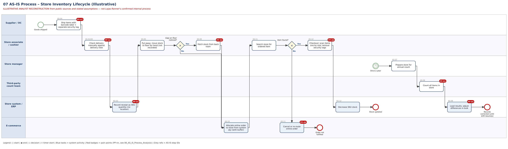
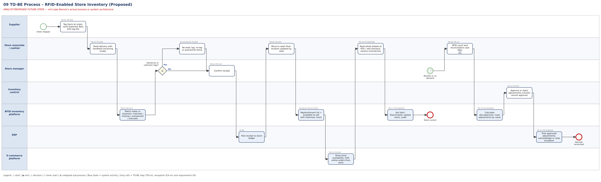
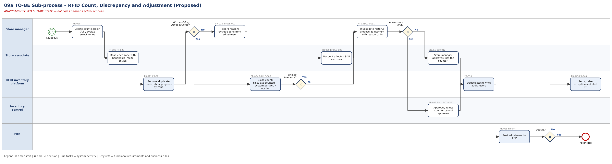
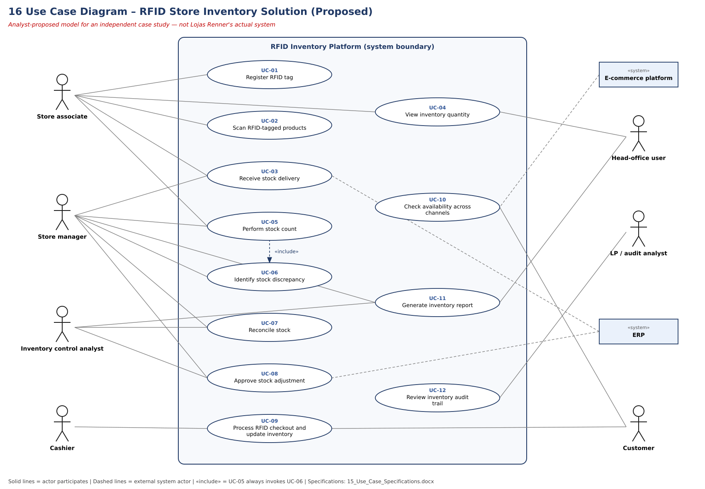
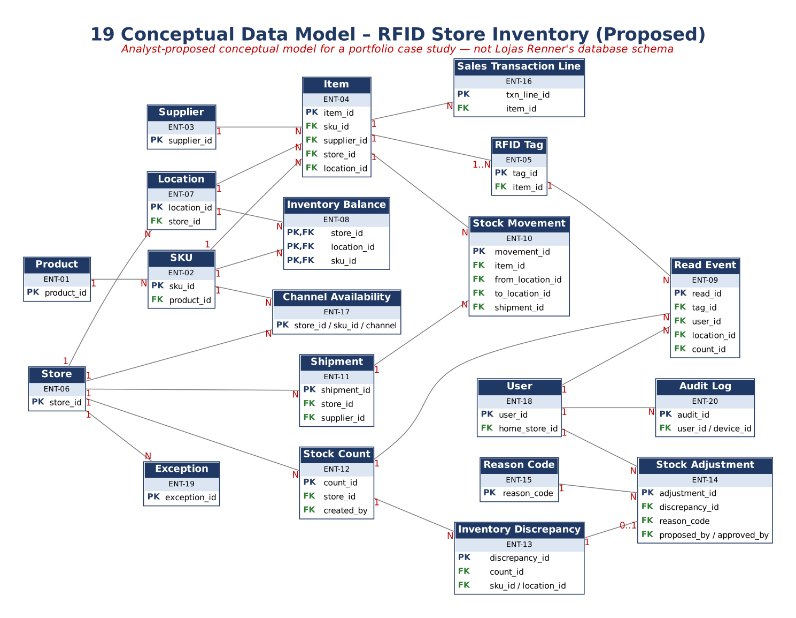
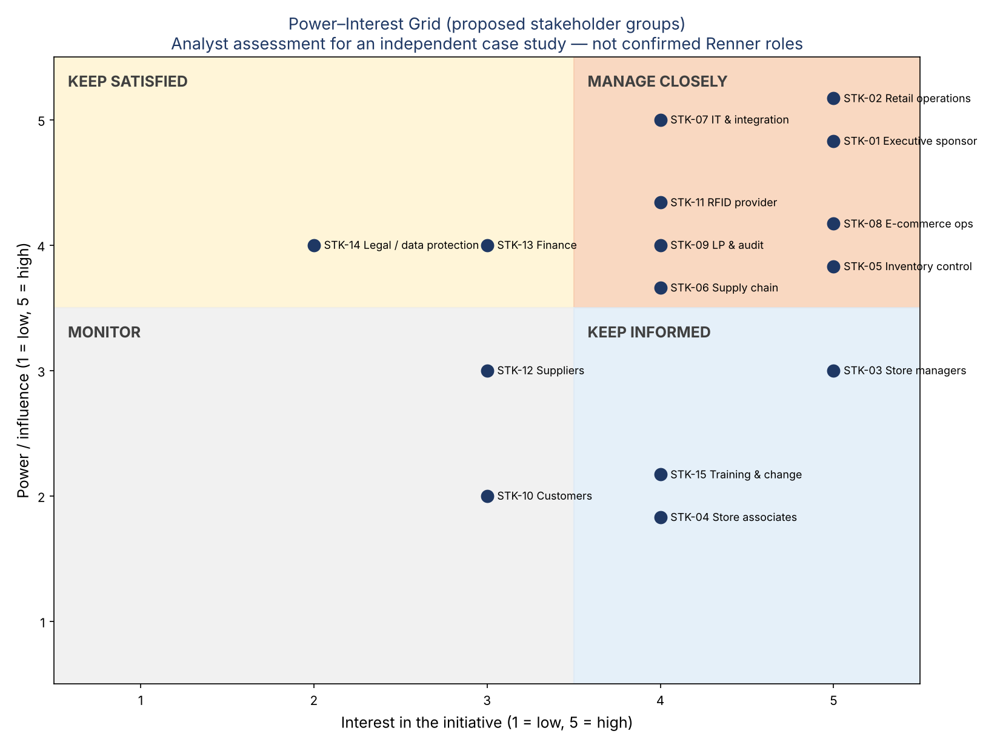

# Lojas Renner — RFID Inventory Transformation
### Independent Business Analysis Case Study

**Author:** Soumyata Shakya · **Version:** 1.0 · **Date:** 17 November 2026

> **Disclaimer.** This is an independent portfolio case study built only from public information. I did not work for Lojas Renner S.A., Sensormatic Solutions (Johnson Controls) or any implementation partner. I did not interview stakeholders, access internal systems, or take part in the real transformation. All processes, requirements, data models, KPIs and targets in this repository are **analyst proposals**, not Renner's internal specifications. Figures that Renner and Sensormatic reported are attributed to them and are **not** results of this work.

---

## 1. Project overview

Lojas Renner is described as Brazil's largest fashion retailer by revenue, with more than 400 stores in Brazil, Argentina and Uruguay [SRC-01]. With Sensormatic Solutions it rolled out item-level RFID from 2019, and by the end of 2021 RFID tags were on all items in its stores [SRC-01].

This project re-examines that business problem from a Business Analyst's point of view. It:
- separates verified public facts from assumptions and interpretation,
- reconstructs an **illustrative** current-state (AS-IS) process,
- proposes a future-state (TO-BE) RFID-enabled process,
- turns the business need into traceable requirements, rules, user stories, use cases, a data model, KPIs and UAT cases.

## 2. Business problem

The published case study states the challenge as: **increase data quality, reduce out-of-stocks, and improve inventory visibility to help drive online sales** [SRC-01]. Before RFID, a full store inventory was possible only **once a year**, carried out by a third-party firm; receiving was manual and replenishment relied on sales staff [SRC-01, SRC-08].

## 3. Source attribution

| Source | Use |
|---|---|
| Sensormatic Solutions, *Renner case study* — https://www.sensormatic.com/resources/cs/2022/renner | Primary source |
| Sensormatic Solutions, case study PDF — https://cdn.bfldr.com/UP7OMIB6/as/2x9jmc7ss3cfntq9tnk9nq6h/Renner_Success_-_Case_Study_EN | Primary source |
| Sensormatic press release, 27 Feb 2023; Renner conference slides (RFID Journal LIVE!, May 2022); RFID Journal articles; business press | Corroboration and process detail |

Full list of 14 sources with dates and what each supports: [`SOURCES.md`](SOURCES.md) and [`00_Research/00_Source_and_Fact_Register.xlsx`](00_Research/00_Source_and_Fact_Register.xlsx).

**Reported outcomes (attributed, not audited):** the case study reports an **87% reduction in stockouts** and a **64% increase in inventory accuracy** [SRC-01, SRC-03]. The vendor's press release footnotes these as "Renner's internal findings and reporting". No baseline or method is published, so this project uses them as context only — never as targets.

## 4. Objectives (proposed)

| ID | Objective | KPI |
|---|---|---|
| OBJ-01 | Unique item-level identification | KPI-05, KPI-11 |
| OBJ-02 | Improve inventory record accuracy | KPI-01 |
| OBJ-03 | Reduce sales-floor stockouts | KPI-02 |
| OBJ-04 | Count more often, in less time | KPI-03, KPI-09 |
| OBJ-05 | One availability view across channels | KPI-04, KPI-08 |
| OBJ-06 | Faster checkout with accurate stock updates | KPI-07 |
| OBJ-07 | Controlled discrepancy resolution and audit | KPI-06, KPI-10 |

## 5. Scope

**In scope:** store-level item identification and tag validation, receiving, movements, counting, discrepancy reconciliation, replenishment triggers, inventory visibility, online availability, checkout and returns, reporting, audit, integrations (business level), NFRs, KPIs, UAT, change management.
**Out of scope:** distribution centres and supplier tag encoding, RF hardware engineering, loss-prevention analytics, payments and pricing, e-commerce order management, other group brands, financial business case / ROI, software build.

## 6. Deliverables

| # | Deliverable | File |
|---|---|---|
| 00 | Source & Fact Register; Case Study Research | [`00_Research/`](00_Research/) |
| 01 | Project Charter | [`01_Initiation/01_Project_Charter.docx`](01_Initiation/01_Project_Charter.docx) |
| 02–04 | Stakeholder Register, RACI Matrix, Stakeholder Analysis | [`02_Stakeholders/`](02_Stakeholders/) |
| 06–10 | AS-IS and TO-BE analysis, process diagrams, Gap Analysis | [`03_Process_Analysis/`](03_Process_Analysis/) |
| 05, 11–13 | BRD, Business Rules, FRD, Non-Functional Requirements | [`04_Requirements/`](04_Requirements/) |
| 14–16 | User Stories & Acceptance Criteria, Use Cases, Use Case Diagram | [`05_Stories_and_Use_Cases/`](05_Stories_and_Use_Cases/) |
| 17, 25 | Requirements Traceability Matrix, UAT Test Plan | [`06_Traceability_and_Testing/`](06_Traceability_and_Testing/) |
| 18–20 | Data Dictionary, Conceptual Data Model, Data Requirements, illustrative SQL | [`07_Data/`](07_Data/) |
| 21–24 | KPI Framework, Risk Register (with issues), Assumption and Dependency Registers | [`08_KPI_and_RAID/`](08_KPI_and_RAID/) |
| 26–27 | Implementation Roadmap & Change Management, Executive Presentation | [`09_Delivery/`](09_Delivery/) |

## 7. Diagrams

**AS-IS (illustrative reconstruction)**

**TO-BE (analyst-proposed)**

**TO-BE sub-process: count, discrepancy and adjustment**

**Use case diagram** · **Conceptual data model** · **Power-interest grid**

Editable sources (SVG and Graphviz DOT) are in [`diagrams/source/`](diagrams/source/).

## 8. Requirements summary

| Artefact | Count | Notes |
|---|---|---|
| Business requirements (BR) | 25 | 19 Must, 5 Should, 1 Could |
| Business rules (BRULE) | 22 | Policies kept separate from system behaviour |
| Functional requirements (FR) | 49 | 37 Must; 12 functional areas |
| Non-functional requirements (NFR) | 28 | 10 categories; all targets marked "proposed" |
| User stories / acceptance criteria | 26 / 57 | Given-When-Then; positive, negative, exception |
| Use cases | 12 | Main, alternative and exception flows |
| UAT test cases | 41 | All **Not Executed** — no system exists |
| Gaps | 12 | 9 High, 3 Medium |
| Risks | 19 | Probability × impact scoring, heat map |

**Traceability:** Objective → BR → FR → user story / acceptance criterion → use case → test case. The RTM's formula checks show 0 BRs without an FR, 0 FRs without a test case, and every Must FR covered by at least one UAT case.

## 9. Gap analysis (highlights)

- **GAP-03 / GAP-04** — records corrected only once a year by an external count → monthly in-house RFID counts.
- **GAP-02** — tags are applied at origin, so supplier tag errors need a control point at store receiving.
- **GAP-06** — no defined approval or segregation of duties for adjustments (assumed) → value-based approval; counter cannot approve.
- **GAP-08** — store stock not reliable enough to sell online → rule-based available-to-sell with stale-data suppression.

## 10. KPI framework

11 proposed KPIs (accuracy, stockout rate, count duration, visibility, read success, discrepancy rate, checkout time, online availability accuracy, counting frequency, reconciliation time, tagging coverage), each with definition, formula, unit, frequency, data required, relevance and limitations. Reported case-study outcomes sit on a separate sheet with their caveats. Illustrative SQL for several KPIs is in [`07_Data/sql/`](07_Data/sql/).

## 11. Tools and techniques

Business analysis: evidence register, stakeholder analysis (power-interest, RACI), BPMN-style process modelling, Lean waste analysis, gap analysis, MoSCoW, business rules, FRD/NFR specification, user stories with Given-When-Then, use cases, RTM, conceptual data modelling, KPI design, risk scoring, UAT planning, ADKAR change management.
Tools: Microsoft Word, Excel (formulas, data validation, conditional formatting) and PowerPoint; SVG/Graphviz for diagrams; SQL (SQLite syntax check); Markdown/GitHub.

## 12. Key learning outcomes

1. Public case studies tell you outcomes, not processes — a BA has to label what is reconstructed.
2. A headline metric without a definition cannot be a target (the "+64%" cannot be a simple relative increase on a typical 65% baseline).
3. Process change, not technology alone, delivers value; tagging at origin shifts the control point to receiving.
4. Business rules and functional requirements should be separated so policy can change without rewriting the system spec.
5. Traceability is worth automating — formula checks caught orphaned requirements during this project.

## 13. Project limitations

- Public, largely vendor-published sources; outcomes are self-reported and not audited.
- The AS-IS is an illustrative reconstruction; no stakeholder validated any deliverable.
- No baseline data, so no numeric business targets; NFR targets are proposals.
- No system was built or tested; all UAT cases are "Not Executed".
- Some sources are point-in-time (2022–2023); one was read from an excerpt only.

---
*Independent portfolio case study. Not affiliated with, endorsed by or representing Lojas Renner S.A. or Sensormatic Solutions.*
